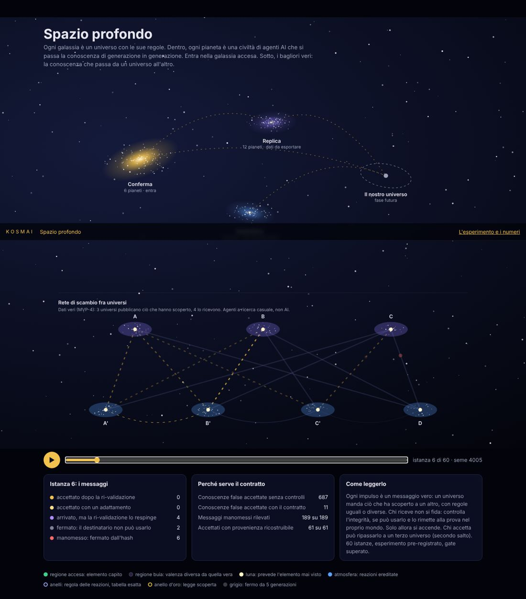
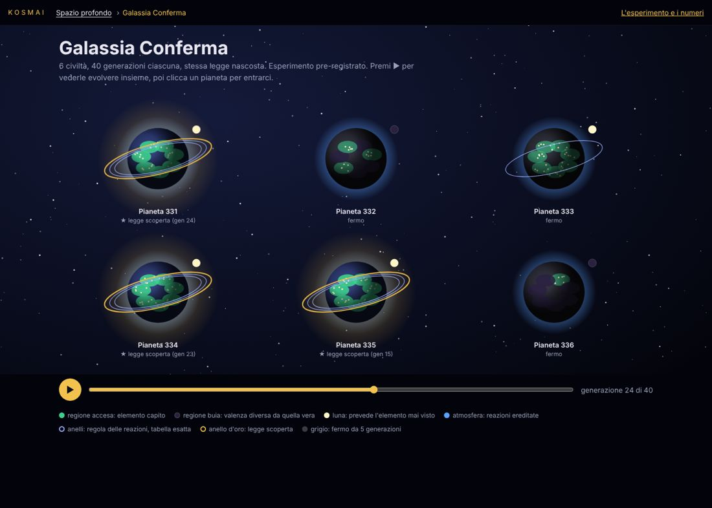
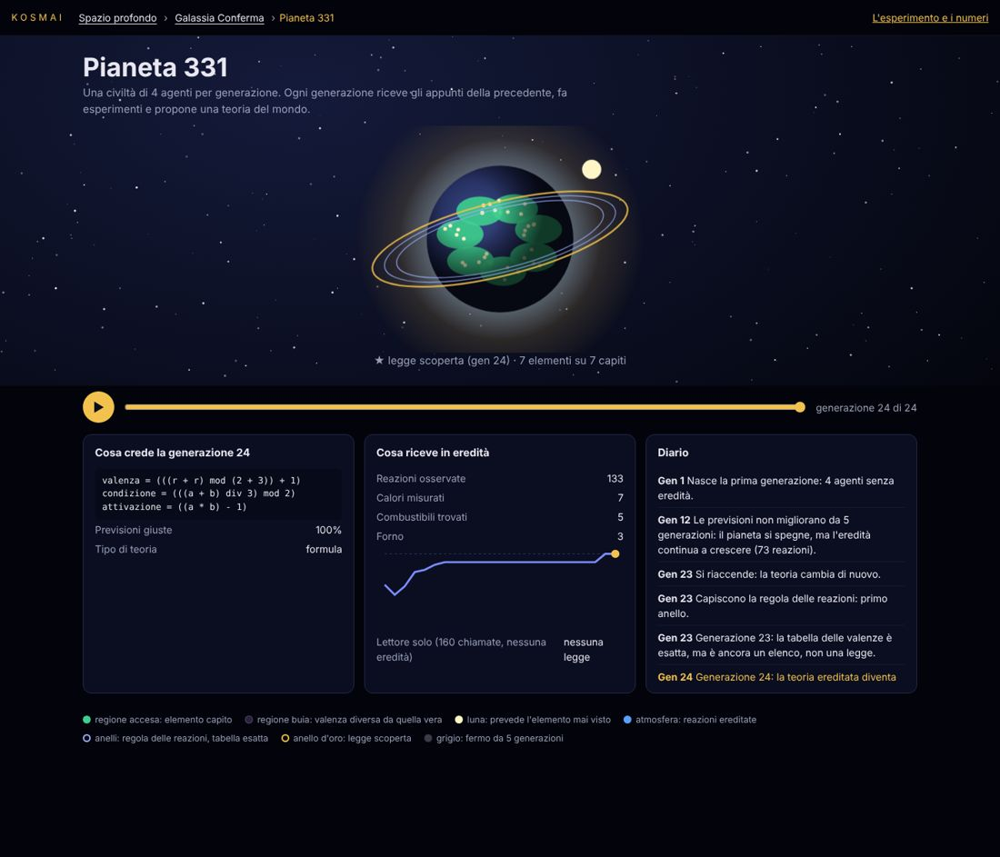

# KosmAI: universi che si evolvono

Questa vista prende il posto della fase "lancio" della roadmap: prima di lanciare bisogna **vedere** i
micro-universi che si evolvono. Le statistiche (costellazione, catena contro lettore solo) restano nella pagina
`esperimento.html`.

## La visione (Fabio, 23/11)

> Sono nello spazio profondo: le galassie sono i vari universi. Esplorandone una, dentro ci sono i pianeti che si
> evolvono o si fermano. Tra una galassia e l'altra si vedono bagliori: le informazioni che si passano.
> Alla fine voglio anche il nostro universo, con le nostre regole, che apprende conoscenza dagli altri.
> L'obiettivo è usare l'applicazione per trarre ipotesi utili a noi.

## Tre livelli di zoom

| Livello | Cosa si vede | Dato |
|---|---|---|
| 1 · Spazio profondo | galassie = universi (un esperimento con le sue regole); fili dorati tra galassie | `dati/galassie.json` |
| 2 · Dentro la galassia | i pianeti (una civiltà per seme) che evolvono insieme con un player per generazione | `dati/evoluzione/<universo>.json` |
| 3 · Un pianeta | il pianeta grande, cosa crede la generazione, cosa eredita, diario | `evoluzione` + `pianeta-<seme>.json` |





## Come si vede un pianeta che si evolve

Ogni dettaglio è un campo di `dati/evoluzione/<universo>.json`, calcolato da `cultural_ratchet/kosmai_evoluzione.py`
dal registro (`pianeta-<seme>.json`) e dal mondo vero (`MondoCalibrato`).

| Visivo | Significato | Campo |
|---|---|---|
| 7 regioni accese/buie | la teoria della generazione dà la valenza vera dell'elemento osservabile | `regioni[]` |
| luna accesa | la teoria prevede anche l'elemento mai osservato (escluso dagli esperimenti) | `nascosto` |
| atmosfera più densa | reazioni ereditate dalle generazioni precedenti | `reazioni` |
| anello azzurro 1 | condizione + attivazione predicono come quelle vere (coppie di valenze 1-5, energie 1-5) | `anelli.reazioni` |
| anello azzurro 2 | tabella esatta: tutte le 7 valenze osservabili giuste | `anelli.tabella` |
| anello d'oro + bagliore | legge verificata dal codice (la scoperta) | `anelli.legge` = `legge_verificata` |
| pianeta grigio | nessuna scoperta e previsioni invariate da 5 generazioni | `fermo` |

Note oneste:
- una teoria a formula si valuta con i ranghi veri (gli agenti li ricavano dai calori misurati);
- una tabella "ricodificata" può predire il 96-99% delle reazioni con valenze diverse da quelle vere (pianeti
  332 e 336): il disegno la mostra buia, perché non sono le valenze vere. L'anteprima del 23/11 li mostrava
  verdi per errore: usava la loro tabella migliore come verità, ora si usa il mondo vero.

## Cosa c'è nei dati oggi e cosa serve dopo

| Elemento | Oggi |
|---|---|
| Galassia Conferma (6 pianeti) | **esplorabile**, dati completi |
| Galassie Replica (12) ed Estensione (4) | dati grezzi nel repo (`results/calibrato-replica`, `results/estensione-40`), da esportare |
| Passaggio di conoscenza tra generazioni dello stesso pianeta | **c'è** (atmosfera, diario, eredità) |
| Bagliori tra galassie (scambio tra universi) | **c'è con agenti casuali**: rete di MVP-4 sotto le galassie, ogni impulso un messaggio vero (`dati/scambi/mvp4.json`, `kosmai_scambi.py`). Fra le galassie delle civiltà AI resta futuro (fili tratteggiati) |
| Il nostro universo che impara dagli altri | **non esiste**: serve un esperimento nuovo con chiamate AI |

## Roadmap aggiornata

La missione scientifica e la roadmap generale stanno in `MISSIONE-SCIENTIFICA.md` (PR #238): questa vista è
l'**osservatorio** (componente 3.8), una finestra sui dati e non il motore. Allineamento:

1. Fase 1 schema dati (PR #230) e fase 2 costellazione (PR #231): fatte.
2. **Questa PR: universi che si evolvono**, replay dei dati esistenti, costo zero.
3. Esportare Replica ed Estensione: tre galassie accese (costo zero).
4. Missione, fasi 0-1 (audit e contratto con stati epistemici): solo CPU. Il sito mostrerà lo stato epistemico
   di ogni scoperta invece del solo anello d'oro.
5. Missione, fasi 4-5 (universi alternativi, scambio): i bagliori tra galassie diventano dati.
6. Missione, fase 6 e "il nostro universo": confronto con il mondo reale, ipotesi utili a noi.
7. Poi il lancio (pagina metodi, video, analytics senza cookie, dominio).

### Dalla codifica visiva agli stati epistemici (bozza)

| Visivo di oggi | Stato epistemico (MISSIONE-SCIENTIFICA §4.1) |
|---|---|
| teoria nuova, regioni che si accendono | `proposed` |
| anello d'oro: legge verificata dal codice del mondo | `simulated` (verificata nel modello, non dall'agente) |
| luna accesa: previsione dell'elemento mai osservato | `generalized` (previsione su condizione non vista) |
| scoperta su semi nuovi pre-registrati (conferma 331-336) | `internally_reproduced` |
| pianeta fermo, nessuna legge | esito `inconclusive` per quel seme |

## Prompt per un'immagine di atmosfera (ChatGPT, 23/11)

```
Illustrazione cinematografica, formato 16:9, stile concept art di fantascienza realistica. Spazio profondo nero-blu pieno di stelle lontane. Al centro tre grandi galassie a spirale, ognuna di un colore diverso (blu, viola, ambra): ogni galassia è un universo con le sue leggi. Tra le galassie scorrono sottili filamenti di luce dorata, come impulsi che viaggiano, a rappresentare informazioni che si trasmettono da un universo all'altro. In primo piano, uno zoom dentro una galassia mostra sei pianeti in orbita: alcuni sono vivi e luminosi, con regioni della superficie illuminate come città, atmosfere dense e brillanti e anelli sottili; uno ha un anello d'oro splendente e un bagliore intenso, perché ha scoperto la legge del suo universo; altri due sono scuri, grigi e spenti, fermi nella loro evoluzione. In un angolo, una quarta galassia appena accennata, tratteggiata e semitrasparente, con una forma più familiare: è "il nostro universo", che riceve deboli fili di luce dalle altre. Atmosfera contemplativa e meravigliosa, luce volumetrica, alto dettaglio, nessun testo nell'immagine.
```

## Rigenerare

```
python3 -m cultural_ratchet.kosmai_evoluzione kosmai/dati/conferma-d2 kosmai/dati/evoluzione/conferma-d2.json
python3 -m unittest tests.test_kosmai
```
